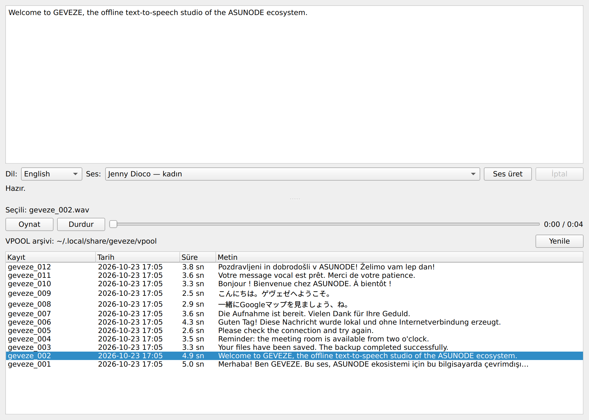
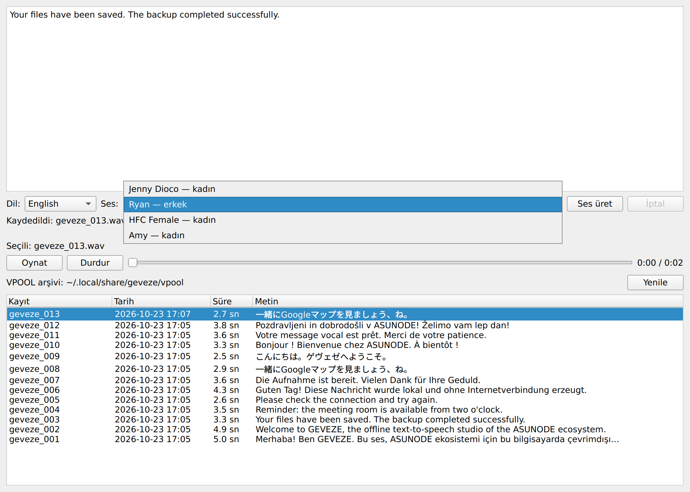
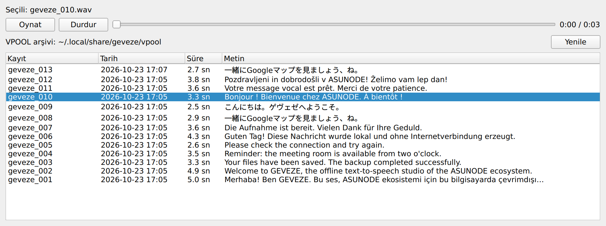
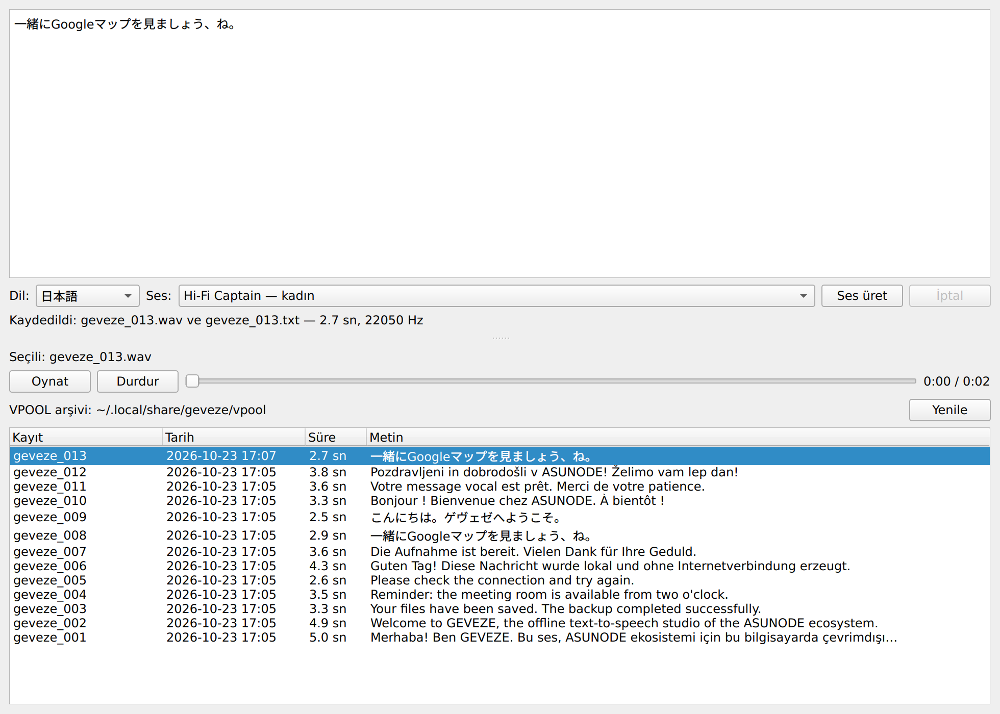

<div align="center">

# GEVEZE

### Çevrimdışı Çok Dilli Metinden Sese Dönüştürme ve Ses Arşivi

**6 dil · 12 ses · yalnızca CPU · bulut yok · her kayıt bir TXT + WAV çifti**

**ASUNODE** ekosisteminin parçası

[English README](README.md) · [Kurulum](docs/installation.md) · [Mimari](docs/architecture.md) · [Lisanslar](docs/third-party-licenses.md)

</div>



## Geveze nedir?

Geveze, metni **tamamen kendi bilgisayarınızda** sese dönüştüren bir masaüstü
uygulamasıdır. Metni yazın, dili ve sesi seçin, **Ses üret**'e basın: Geveze sesi CPU
üzerinde üretir, çalar ve metinle sesi yan yana, sade dosyalardan oluşan bir arşivde
saklar.

ASUNODE içindeki görevi, diğer ASUNODE uygulamalarının daha sonra kendileri ses
üretmeden çalabileceği **hazır sesli mesajlar** (duyurular, onaylar, hatırlatmalar)
hazırlamaktır. Her mesaj iki sıradan dosyadır (`geveze_007.txt` + `geveze_007.wav`);
herhangi bir program bunları bulup yeniden kullanabilir.

> **Durum:** Geveze çalışan, tek kullanıcılı bir masaüstü aracıdır. Sunucu, API veya
> anlık sesli asistan değildir (ASUNODE Local Voice Assistant ayrı bir projedir).
> Yeni mesajların yerel bir LLM tarafından otomatik hazırlanması gelecekteki bir
> hedeftir; şu anda bulunan bir özellik değildir.

## Özellikler

- **Altı dil, on iki ses**; Japonca ve Fransızcada aynı modelin kadın/erkek konuşmacıları.
- **Çevrimdışı:** kurulumdan sonra ağ bağlantısı kullanılmaz; ağ kapalıyken test edildi.
- **Yalnızca CPU:** GPU, CUDA, sunucu, veritabanı veya arka plan hizmeti yok.
- **TXT/WAV çiftlerinden oluşan arşiv:** tarih, süre ve metin önizlemesi; her kayıt çalınabilir.
- **Üzerine yazmaz:** yeni kayıt her zaman yeni bir numara alır; var olan dosyalar eşzamanlı
  yazmalarda bile değiştirilmez.
- **Unicode birebir:** metin yazıldığı gibi bayt bayt saklanır — Kanji, Kana, aksanlar,
  Slovence č/š/ž, ayrışık (NFD) biçimler.
- **Donmayan arayüz:** sentez ayrı süreçte çalışır; iptal edilebilir, 10 dakikada zaman aşımına uğrar.

## Diller ve sesler

| Dil | Ses | Cinsiyet | Model | Örnekleme |
| --- | --- | --- | --- | --- |
| Türkçe | EMA Lightning | kadın | `canberkkkkkk/ema-lightning` | 48 kHz |
| English | Jenny (Dioco) — *varsayılan* | kadın | `en_GB-jenny_dioco-medium` | 22,05 kHz |
| English | Ryan ⚠ | erkek | `en_US-ryan-high` | 22,05 kHz |
| English | HFC Female ⚠ | kadın | `en_US-hfc_female-medium` | 22,05 kHz |
| English | Amy | kadın | `en_US-amy-medium` | 22,05 kHz |
| Deutsch | Thorsten — *varsayılan* | erkek | `de_DE-thorsten-high` | 22,05 kHz |
| Deutsch | Kerstin | kadın | `de_DE-kerstin-low` | 16 kHz |
| 日本語 | Hi-Fi Captain ⚠ — *varsayılan* | kadın | `ja_JP-hi_fi_captain-medium`, konuşmacı 0 | 22,05 kHz |
| 日本語 | Hi-Fi Captain ⚠ | erkek | `ja_JP-hi_fi_captain-medium`, konuşmacı 1 | 22,05 kHz |
| Français | Jessica — *varsayılan* | kadın | `fr_FR-upmc-medium`, konuşmacı 0 | 22,05 kHz |
| Français | Pierre | erkek | `fr_FR-upmc-medium`, konuşmacı 1 | 22,05 kHz |
| Slovenščina | Artur | erkek | `sl_SI-artur-medium` | 22,05 kHz |

⚠ = CC BY-NC-SA 4.0 verisiyle eğitilmiştir: **ticari kullanıma uygun değildir**. Amy ve
Kerstin'in lisans durumu açıklığa kavuşmamıştır. Bkz. [Lisanslar](#lisanslar).



## Teknik mimari

```text
 Geveze arayüzü (Python 3 + PySide6)
   │  geveze_NNN.txt yazar (yalnızca yeni dosya oluşturur)
   │  motoru QProcess ile başlatır ──────────────────┐
   ▼                                                 ▼
 Arşiv (VPOOL)                      EMA Lightning (Türkçe)   ─ kendi Python 3.12 ortamı, PyTorch CPU
   geveze_NNN.txt  ◄── os.link ──   Piper + ONNX Runtime     ─ kendi Python 3.12 ortamı
   geveze_NNN.wav                   (eSpeak NG / OpenJTalk)
```

- Arayüz hiçbir motoru içe aktarmaz; her motoru kendi yorumlayıcısıyla argüman listesi
  vererek çalıştırır ve biten WAV'ı geri okur.
- Motorlar önce geçici dosyaya yazar ve onu var olan dosyanın yerine geçmeyi reddeden
  `os.link` ile yayımlar. Geveze başarıyı bildirmeden önce WAV'ı doğrular.
- Model dosyaları sabit Hugging Face revizyonlarına bağlıdır ve SHA-256 ile doğrulanır.

Ayrıntılar: [docs/architecture.md](docs/architecture.md) (İngilizce).

## Kurulum

Gereksinimler: x86_64 Ubuntu (26.04 üzerinde test edildi), `git`, kurulum sırasında
internet bağlantısı (~1,4 GB indirme), yaklaşık 2,8 GB disk alanı.

```bash
git clone https://github.com/asunode/geveze.git
cd geveze
./setup.sh
./run.sh
```

`setup.sh` önce model lisanslarını gösterir ve onay ister; ardından her şeyi **klonlanan
klasörün içine** kurar: sürümü sabit `uv`, Python 3.12.15, her motor için ayrı sanal ortam
(tüm paketler hash ile doğrulanır), ses modelleri (boyut ve SHA-256 ile doğrulanır) ve
yalnızca sistemde PySide6 yoksa bir PySide6 ortamı. `sudo` kullanmaz, sistem Python'unu
değiştirmez. Tekrar çalıştırmak güvenlidir.

Tam kılavuz, seçenekler ve sorun giderme: [docs/installation.md](docs/installation.md) (İngilizce).

## Kullanım

```bash
./run.sh                          # arşiv: ~/.local/share/geveze/vpool
./run.sh --vpool ~/Ses/mesajlar   # var olan herhangi bir klasör
GEVEZE_VPOOL=~/Ses/mesajlar ./run.sh
```

1. Metni yazın veya yapıştırın.
2. **Dil** ve **Ses** seçin.
3. **Ses üret**'e basın. Durum satırı ilerlemeyi gösterir; **İptal** üretimi durdurur.
4. Bitince kayıt arşivde seçilir ve otomatik çalınır.
5. Herhangi bir kaydı seçip **Oynat**'a basın veya çift tıklayın; **Yenile** arşivi yeniden okur.

## TXT/WAV kayıt mantığı



Her üretim, arşiv klasöründe (VPOOL) tam olarak iki dosya oluşturur:

```text
~/.local/share/geveze/vpool/
├── geveze_001.txt   # metin, UTF-8, yazıldığı gibi
├── geveze_001.wav   # mono 16 bit PCM WAV
├── geveze_002.txt
├── geveze_002.wav
└── …
```

- Sıradaki numara, var olan en büyük `geveze_NNN` numarasının bir fazlasıdır; TXT'si veya
  WAV'ı zaten bulunan numaralar atlanır. Hiçbir dosya yeniden adlandırılmaz veya üzerine yazılmaz.
- Üretim başarısız olursa veya iptal edilirse Geveze yalnızca o kayıt için az önce
  oluşturduğu dosyaları kaldırır; diğer dosyalara dokunmaz.
- Diğer uygulamalar klasörü doğrudan okuyabilir: `.txt`, `.wav`'ın ne söylediğini belirtir.
- Arşiv deponun dışındadır; Geveze klasörünü güncellemek veya silmek kayıtları etkilemez.

## Unicode ve Japonca



Geveze metni hiçbir normalleştirme veya harf çevirisi yapmadan saklar. Testler Japonca,
Fransızca, Slovence, ayrışık (NFD) metin ve ideografik boşluk için kaydedilen baytları
doğrular.

**Unicode metnin kayıpsız korunması, telaffuzun doğru olduğunu tek başına kanıtlamaz.**
Telaffuz, her motorun metin ön ucundan gelir:

| Japonca girdi | Sonuç |
| --- | --- |
| Kanji / Hiragana / Katakana: `一緒にGoogleマップを見ましょう、ね。` | Doğru okunuşa çevrilir (OpenJTalk: イッショニグーグルマップヲミマショー、ネ) |
| Japonca cümle içinde sözlükte **bulunan** Latin kelime: `Google` | グーグル olarak okunur |
| Sözlükte **bulunmayan** Latin kelime: `Geveze` | Harf harf okunur (ジーイーブイイーゼットイー) — bunun yerine ゲヴェゼ yazın |
| **Romaji** ile yazılmış Japonca: `konnichiwa` | **Japonca olarak okunmaz** — harf harf okunur (ケーオーエヌエヌアイ…) |

Geveze henüz Romaji → Japonca karakter dönüşümü **yapmıyor**. Japonca metni Japonca
karakterlerle yazın.

## Çevrimdışı çalışma

Ağı yalnızca `setup.sh` kullanır. Sentez sırasında EMA motoru `HF_HUB_OFFLINE=1` ve
kapalı telemetriyle çalışır; Piper yerel ONNX dosyalarını CPU'da yükler. Temiz kurulum
testinde on iki sesin tamamı `--network none` ile başlatılan bir kapsayıcıda üretildi.

## Lisanslar

| Katman | Lisans |
| --- | --- |
| Geveze kaynak kodu (bu depo) | [MIT](LICENSE) |
| EMA Lightning motoru | Apache-2.0 |
| Piper motoru (eSpeak NG ile) | GPL-3.0-or-later — PyPI'den ayrıca kurulur, ayrı süreçte çalışır |
| PySide6 / Qt | LGPL-3.0 (açık kaynak seçeneği) |
| Ses modelleri | Kendi lisansları — özgün kaynaklarından indirilir, bu depoda **bulunmaz** |

Ticari kullanım:

- **Uygun değil** (ticari olmayan eğitim verisi, CC BY-NC-SA 4.0): Ryan, HFC Female,
  Hi-Fi Captain kadın ve erkek.
- **Belirsiz, uygun varsaymayın**: Amy, Kerstin.
- **Atıf gerekli**: Jenny — *Jenny (Dioco)* olarak belirtin; Jessica/Pierre (CC BY-SA 4.0);
  Artur (CC BY 4.0 / 3.0).
- **Model kartına göre izinli**: EMA Lightning (kod ve ağırlıklar için Apache-2.0).

Geveze, üretilen seslerin her amaçla serbestçe kullanılabileceğini iddia etmez. Tüm
ayrıntılar, kaynaklar ve açık sorular: [docs/third-party-licenses.md](docs/third-party-licenses.md).

## Test ve doğrulama sonuçları

Temiz kurulum testi, 23 Ekim 2026; yeni bir `ubuntu:26.04` Docker kapsayıcısında (root
olmayan kullanıcı, önceden kurulu PySide6 yok, kurulum yolunda boşluk ve Türkçe karakter
var). Depo `git clone` ile alındı ve yukarıdaki gibi `./setup.sh` ile kuruldu.

| Denetim | Sonuç |
| --- | --- |
| Etkileşimsiz kabukta lisans onayı olmadan `setup.sh` | Hiçbir şey indirmeden duruyor |
| `setup.sh --accept-model-licenses` | Tamamlandı; 31 model dosyası boyut ve SHA-256 ile doğrulandı; üç ortamda da `uv pip check` temiz |
| `setup.sh` tekrar çalıştırma | Var olan ortamlar kullanıldı, model dosyaları değişmedi, önceden var olan arşiv kaydı değişmedi (SHA-256) |
| 12 sesin tamamı gerçek pencereden, **ağ kapalıyken** | 12/12 geçerli WAV (beklenen 48 / 22,05 / 16 kHz), doğru `--voice`/`--speaker`, metin bayt bayt aynı |
| Arşiv konumu | `~/.local/share/geveze/vpool`, deponun dışında |
| Oynatma (QMediaPlayer) | Konum ilerliyor (kapsayıcıda PulseAudio null çıkışı kullanıldı) |
| Motor güvenliği | Var olan çıktı reddedildi; geçersiz konuşmacı kimliği reddedildi |
| Otomatik test paketi (`tests/test_geveze.py`) | 32 test: 27 başarılı, 5 atlandı (isteğe bağlı gerçek arşiv testleri) |

Test paketi ayrıca benzersiz adlandırmayı, üzerine yazmama garantisini, hata ve iptal
sonrası temizliği, sentez sırasında arayüzün donmadığını (250 ms'yi aşan olay döngüsü
boşluğu yok) ve kadın/erkek konuşmacıların perdesinin farklı olduğunu (NumPy ile F0
ölçümü) denetler.

Doğrulanmayanlar: ikinci bir fiziksel bilgisayarda kurulum, başka dağıtımlar veya Ubuntu
sürümleri, ARM64 ve anlaşılırlık için dinleme testleri. Bu testte ses kalitesi teknik
olarak (WAV yapısı, süre, sinyal düzeyi) denetlendi, kulakla değil.

## Bilinen sınırlamalar

- Yalnızca Linux x86_64; arayüz Türkçedir.
- Romaji Japonca karakterlere çevrilmez; sözlük dışı Latin kelimeler Japoncada harf harf okunur.
- Arşiv, WAV'ın hangi sesle üretildiğini kaydetmez.
- Model her üretimde yeniden yüklenir: test makinesinde kısa bir cümle için 1,5–3 sn;
  kurulumdan sonraki ilk Türkçe üretim yaklaşık 15 sn sürdü.
- Arşivde silme, yeniden adlandırma ve arama yok; çok uzun metinleri bölme ve ilerleme çubuğu yok.
- Kurulum yaklaşık 2,8 GB disk alanı ister; altı dilin tamamı her zaman kurulur.
- Motorlar WAV dosyalarını yalnızca sahibinin okuyabileceği izinlerle (0600) oluşturur.
- Bazı sesler ticari kullanıma uygun değildir (yukarıya bakın).

## Gelecekteki geliştirme hedefleri

- Her kaydın hangi sesle üretildiğini göstermek.
- İsteğe bağlı, dil bazında kurulum.
- Diğer ASUNODE uygulamalarının mesaj isteyip yeniden kullanabileceği bir arayüz.
- Yeni ve tekrar kullanılabilir mesajların yerel LLM desteğiyle hazırlanması (planlandı, başlanmadı).
- Japonca için isteğe bağlı Romaji → Kana dönüşümü.

## Depo yapısı

```text
geveze/
├── README.md, README.tr.md, LICENSE
├── setup.sh                    # kurulum (her şey bu klasörde kalır)
├── run.sh                      # başlatıcı
├── requirements-gui.lock       # PySide6; yalnızca sistemde yoksa kullanılır
├── geveze/                     # uygulama: core.py (mantık), app.py (pencere)
├── engines/
│   ├── fetch_models.py         # doğrulamalı model indirici
│   ├── ema/                    # synthesize.py, kilit dosyaları, models/manifest.json
│   └── piper/                  # synthesize.py, kilit dosyası, models/manifest.json
├── tests/test_geveze.py
└── docs/                       # kurulum, mimari, lisanslar, görseller
```
